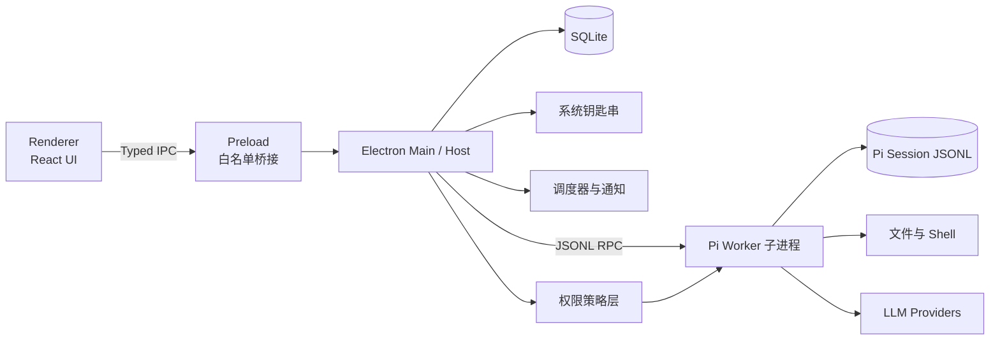

# PI Agent Desktop

一个基于 [Pi Agent](https://pi.dev/docs/latest) 构建的本地优先桌面 AI 工作台。

它不仅是 Pi 终端界面的图形化封装，还负责用户界面、权限控制、后台调度、系统通知、连接器和本地数据管理。Pi 负责 Agent Loop、模型调用、工具执行和会话机制，桌面 Host 负责完整的产品体验。

> 当前状态：项目初始化阶段。已完成 Electron + React + TypeScript 基础工程，下一步进行 Pi RPC 技术验证。

## 产品定位

PI Agent Desktop 面向希望长期使用 AI 完成开发、信息整理和本地知识处理的个人用户，提供统一的桌面工作台：

- 像聊天应用一样自然地提出任务
- 实时查看模型输出、工具调用和任务进度
- 使用文件、Shell、网页、订阅源和定时任务
- 在执行高风险操作前获得明确的审批信息
- 将会话、资料和运行记录保存在本地

产品采用“本地优先”原则。用户数据默认存储在本机；需要多设备同步、团队协作或托管定时任务时，再引入可选云控制面。

## 产品原则

1. **Pi 管 Agent**：模型请求、工具循环、上下文、会话分支和压缩由 Pi 负责。
2. **Host 管产品**：窗口、交互、调度、连接器、通知和数据索引由桌面应用负责。
3. **策略层管权限**：高风险能力必须经过代码级权限策略，不能只依赖提示词约束。
4. **过程透明**：用户能够看到 Agent 正在做什么、访问什么以及产生了什么结果。
5. **随时可停止**：每个运行中的任务都必须支持中止、清理和恢复。

## 产品框架

### 1. 左侧导航

- 新对话
- 灵感与 Skills
- 定时任务
- 文件与资料库
- 最近会话
- 设置
- 审计日志

### 2. 中央对话工作台

- 流式文本与 Markdown
- 来源引用和附件
- 工具调用过程卡片
- 命令和权限审批
- 任务步骤与执行状态
- 停止、重试和继续执行
- `@` 引用文件
- `/` 调用命令、模板和 Skills

消息区域不能只按照普通聊天气泡设计，还需要承载思考状态、工具参数、增量输出、执行结果、错误和恢复操作。

### 3. 右侧运行检查器

- 当前任务步骤
- 待审批操作
- 已修改文件
- 终端输出
- 引用来源
- 上下文使用量
- Token 与费用

### 4. Agent 能力

- Pi 会话创建、恢复和分支
- 模型与 Thinking Level 切换
- Skills、Extensions 和 Prompt Templates
- 项目文件读取与编辑
- Shell 命令执行
- 上下文压缩
- 工具调用事件流

### 5. 个人助理能力

Pi 默认更接近本地编码 Agent。要实现个人信息助理，还需要由 Host 或 Pi Extension 补充：

- RSS 和订阅管理
- 网页抓取与来源引用
- 定时任务
- 后台执行
- 系统通知
- 长期记忆
- 本地资料库
- 文档索引与搜索

## 技术架构



### Renderer

负责 React 界面、消息渲染、路由和用户交互。

- 开启 `contextIsolation`
- 关闭 `nodeIntegration`
- 不直接访问文件系统、Token、数据库或 Shell
- 只能调用 Preload 暴露的强类型白名单接口

### Preload

提供最小化 IPC 桥接：

- 会话命令
- Pi 运行控制
- 文件选择
- 设置读取与更新
- 主进程事件订阅

Preload 不承载业务逻辑。

### Electron Main / Host

负责桌面应用的核心编排：

- 窗口和应用生命周期
- Pi Worker 生命周期
- IPC 合约
- SQLite
- 凭据管理
- 权限策略
- 后台任务
- 系统通知
- 审计日志

### Pi Worker

以独立子进程运行 Pi RPC：

- 接收 prompt 和控制命令
- 流式输出文本、工具和会话事件
- 运行 Agent Loop
- 执行 Pi 工具
- 管理 Session
- 支持中止、重启和异常恢复

进程隔离不等于安全沙箱，但可以隔离崩溃、控制生命周期，并避免 Pi 与 Electron Main 共享全部内存状态。

## 为什么首选 Pi RPC

Pi 提供 TypeScript SDK 和 RPC 两种主要嵌入方式。

首版选择 **RPC 子进程**：

- 适合自定义桌面界面和 IDE 类集成
- 可以独立停止或重启 Agent
- Pi 崩溃不会直接拖垮 Electron Main
- 通过 JSONL 接收完整运行事件
- 更容易为不同任务建立独立运行边界

仅在内部工具或明确接受同进程权限、故障影响时，才考虑直接使用 Pi SDK。

## 技术选型

| 层 | 推荐方案 | 说明 |
| --- | --- | --- |
| 桌面容器 | Electron + electron-vite | 与 Pi 的 Node/TypeScript 生态兼容，MVP 成本最低 |
| UI | React + TypeScript | 适合流式消息、工具卡片和复杂状态 |
| 样式与组件 | Tailwind CSS + Radix UI | 建立一致、可访问的桌面设计系统 |
| Agent 桥接 | Pi RPC + 独立子进程 | 支持事件流、停止、重启和故障隔离 |
| 客户端状态 | Zustand | 管理窗口、选中会话和运行状态 |
| 业务数据 | SQLite + Drizzle | 保存产品元数据、计划任务和审计记录 |
| Pi 会话 | Pi JSONL SessionManager | 保留分支、压缩和恢复语义 |
| 密钥 | Electron `safeStorage` / 系统钥匙串 | Token 不以明文写入数据库 |
| 后台任务 | Main 调度器 + Pi Worker | 应用最小化后继续执行任务 |
| 单元测试 | Vitest | 覆盖领域逻辑和 IPC 合约 |
| 端到端测试 | Playwright | 覆盖桌面关键流程 |

### Electron 与 Tauri

首版选择 Electron，因为它能直接利用 Node 生态和 Pi 的 TypeScript/RPC 客户端，开发与调试成本最低。

当安装包体积、常驻内存和系统资源成为核心商业指标后，再评估 Tauri + Pi Sidecar。Tauri 不会消除 Pi 的运行时需求，反而会增加 Rust Host 与 Node Sidecar 的打包和通信复杂度。

## 数据所有权

### Pi JSONL

作为以下数据的权威来源：

- 消息
- 模型响应
- 工具调用及结果
- 会话分支
- 上下文压缩记录
- Pi 运行事件

### SQLite

只保存产品层数据和检索索引：

- 工作区
- 会话索引
- 任务与运行记录
- 定时任务
- 连接器配置
- 文件和资料索引
- 权限授予记录
- 审计日志

不要在 SQLite 中复制一份完整 Pi 会话状态，避免双写和状态不一致。

### 附件

附件存放在应用数据目录，通过内容哈希组织；SQLite 保存元数据、引用关系和权限信息。

## 核心领域对象

- `Workspace`：Agent 可以访问的项目或资料范围
- `Session`：一次持续对话，对应 Pi Session
- `Run`：某次 Agent 执行
- `ToolInvocation`：工具调用、参数、结果和审批状态
- `Artifact`：文件、报告、代码或其他执行产物
- `Schedule`：定时任务定义
- `Connector`：RSS、网页、日历等外部能力
- `PermissionGrant`：一次性或作用域化授权
- `AuditEvent`：安全和运行审计记录

## 安全基线

Pi 工具和 Extension 使用 Pi 进程的操作系统权限，项目信任机制不等于工具沙箱。

首版必须满足：

- Renderer 禁止直接使用 Node API
- IPC 使用白名单和运行时参数校验
- Token 使用系统安全存储
- 写文件、Shell、网络和敏感目录访问支持风险分级审批
- 审批界面展示真实参数、目标和影响范围
- 所有运行任务都能强制停止
- 不可信项目或无人值守任务使用容器、虚拟机或 OS 沙箱
- Extension 只允许加载可信来源
- 日志默认脱敏，不记录 Token 和完整敏感文件内容

## 项目目录

```text
PI-AGNET/
├── build/                     # Electron 打包资源
├── src/
│   ├── main/                  # Electron Main / Host
│   ├── preload/               # 强类型 IPC 桥接
│   └── renderer/              # React UI
├── electron.vite.config.ts
├── electron-builder.yml
└── package.json
```

计划随着功能实现演进为：

```text
src/
├── main/
│   ├── pi/                    # Pi RPC 进程与事件适配
│   ├── ipc/                   # IPC handlers 与 schema
│   ├── database/              # SQLite / Drizzle
│   ├── permissions/           # 工具权限策略
│   ├── scheduler/             # 后台与定时任务
│   └── services/              # 通知、凭据、文件等系统服务
├── preload/
├── renderer/
│   └── src/
│       ├── components/
│       ├── features/
│       │   ├── chat/
│       │   ├── sessions/
│       │   ├── runs/
│       │   ├── approvals/
│       │   ├── files/
│       │   └── settings/
│       └── stores/
└── shared/                    # IPC 合约和共享领域类型
```

## MVP 路线

### P0：技术验证（3–5 天）

目标：

- Electron 启动 Pi RPC
- 发送一次真实 Prompt
- 接收流式文本和工具事件
- 中止并清理 Pi 子进程
- 恢复已有 Pi Session
- 验证工具审批拦截
- 验证打包后的 Pi 路径和运行环境

这一阶段只做最小界面，不优先处理视觉细节。

### P1：可用 MVP（3–4 周）

- 对话工作台
- 会话列表与恢复
- 模型设置
- 文件附件
- 工具调用卡片
- 权限审批
- 错误和重试
- 日志与诊断
- macOS / Windows 安装包

### P2：个人助理化（2–3 周）

- RSS 与网页工具
- 来源引用
- 定时任务
- 后台执行
- 系统通知
- 本地资料库和搜索

### P3：平台化

- Skill 与 Extension 管理
- 连接器系统
- 权限清单
- 可选云同步
- 多设备
- 团队协作

## MVP 验收标准

- 首次启动可以配置模型并完成一次真实对话
- 文本、工具开始、增量输出、结果和错误均能正确渲染
- 用户可以随时停止任务，且不会残留 Pi 子进程
- 重启应用后可以恢复会话
- 高风险工具调用会展示参数并要求审批
- Renderer 无法直接读取 Token、文件系统或执行命令
- 核心流程在 macOS 和 Windows 安装包中可运行
- 日志能够区分 Provider、RPC、工具和数据库故障

## 首版不做

- 多端同步
- 团队协作
- 插件市场
- 移动端
- 复杂 RAG 平台
- 全自动长期运行
- 自研模型网关

这些能力会显著扩大安全和运维范围，应在本地单用户闭环稳定后再引入。

## 开发环境

- Node.js：`20.19+` 或 `22.12+`
- npm：随 Node.js 安装
- macOS / Windows / Linux

推荐使用 VS Code 或 Cursor，并安装 ESLint 与 Prettier 扩展。

## 启动项目

安装依赖：

```bash
npm install
```

启动开发环境：

```bash
npm run dev
```

类型检查：

```bash
npm run typecheck
```

代码检查：

```bash
npm run lint
```

构建应用：

```bash
npm run build
```

打包：

```bash
npm run build:mac
npm run build:win
npm run build:linux
```

## 相关资料

- [Pi 官方文档](https://pi.dev/docs/latest)
- [Pi SDK](https://pi.dev/docs/latest/sdk)
- [Pi RPC](https://pi.dev/docs/latest/rpc)
- [Pi 工作原理](https://pi.dev/docs/latest/how-pi-works)
- [Pi Extensions](https://pi.dev/docs/latest/extensions)
- [electron-vite](https://electron-vite.org/guide/)

## License

待定。
